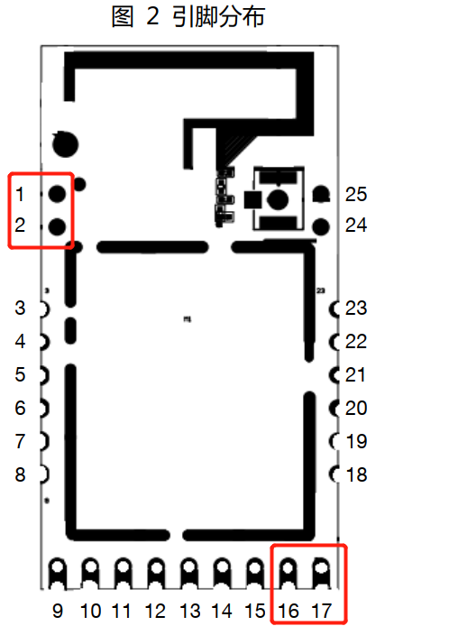
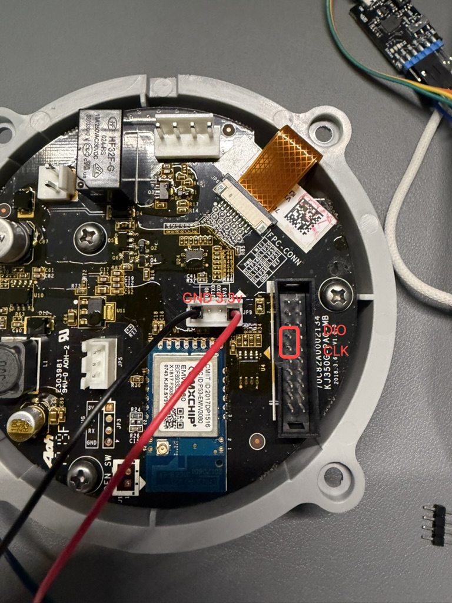
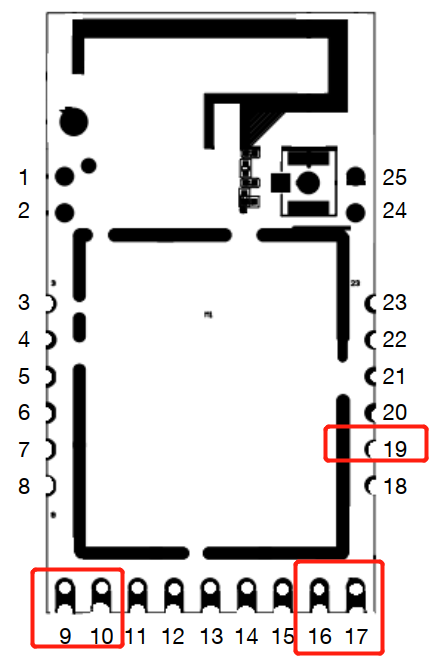

# A1 / M1 刷机

适用于原装 **EMW3080B / MK3080B** 模块的 A1 空气净化器和 M1 空气检测仪。两者的模块接口相同，**固件必须按产品分别下载，不能混刷**。TC1 的 A1 硬件版本是另一款产品，见 [TC1 刷机](tc1-flash)。

先阅读[刷机前准备](flash-prep)，断开市电、原电源及负载，烧录期间使用独立稳定的 **3.3V** 电源。刷写前保存本机完整 Flash 备份；完整镜像会覆盖 Bootloader、原固件及部分设置。

## 选择刷机方式

- [J-Link 刷机](#j-link-刷机)：使用调试器通过 SWD 写入。
- [Bootloader 刷机](#bootloader-刷机)：使用 USB-TTL 串口，不需要 J-Link。

| 方式 | 工具与适用情况 |
| --- | --- |
| J-Link | J-Link + OpenOCD（Windows / Linux）；校验并分段写入完整镜像，适用于首刷和恢复。A1 可以使用工厂测试点接杜邦线 |
| 串口 Bootloader | 3.3V USB-TTL + YMODEM 软件；要求原 Bootloader 正常。M1 模块附近空间较充裕，不想购买 J-Link 时可选此方法 |

| 设备 | J-Link 完整镜像 | 串口镜像准备的输入文件 |
| --- | --- | --- |
| A1 空气净化器 | `phicomm_a1.all.bin` | `phicomm_a1.ota.bin.raw` |
| M1 空气检测仪 | `phicomm_m1.all.bin` | `phicomm_m1.ota.bin.raw` |

从下载页选择产品并下载固件和 `SHA256SUMS`，校验通过再操作。`.ota.bin` / `.ota.bin.signed` 用于网页签名升级，不能直接当作完整镜像或串口用户应用发送。

## J-Link 刷机

### 模块点位：A1 / M1 均可飞线

两款设备都可以在模块对应焊盘焊接导线。下图为模块正向引脚图，按引脚编号确认方向。



| 模块引脚 | 连接 |
| --- | --- |
| 1 或 3：SWD_CLK | J-Link SWCLK（标准 20 针接口 9） |
| 2 或 4：SWD_DIO | J-Link SWDIO（标准 20 针接口 7） |
| 16：VCC | 独立电源 3.3V，并接 J-Link VTref（标准接口 1） |
| 17：GND | 电源负极与 J-Link GND（标准接口 4）共地 |

**VTref 是电压检测输入，不是电源输出。不要连接 J-Link 的 5V 输出。** 小型下载器按自身的信号标记接线，不要照搬标准接口针号。J-Link 方式不需要把串口 BOOT 引脚拉低。


### A1 工厂测试点：可直接插杜邦线

A1 可使用下图标出的工厂点位，免去在模块焊盘飞线：**JP9 的 GND / 3V3 用于供电，DIO / CLK 用于 SWD**。图中 JP9 同时有 UART TX/RX，不要把它们误接到 SWD。DIO、CLK 按新版照片的红框定位：**以照片方向为准，上方为 DIO，下方为 CLK**；杜邦线或排针接触必须牢固。



图中的 VCC 指模块 **3.3V**，不是原机电源输入。接线前断开原电源和风机；照片中的线色仅供定位，以丝印与信号名为准。M1 使用上方模块 SWD 点位。

### 准备 OpenOCD 工具与脚本

本节使用 **OpenOCD + J-Link（SWD）**，不需要安装或打开 mlink / mflash。Windows 使用工具包自带的旧版 OpenOCD；Linux 使用 OpenOCD 0.11 / 0.12 和配套的新配置。两者都需要同一份 `flash_prog.elf`，不能仅安装系统 OpenOCD 后直接运行 `program all.bin`。

下载并解压到短路径（例如 Windows 的 `C:\phicomm`、Linux 的 `~/phicomm`）：

- [EMW3080 脚本包](assets/tools/emw3080-openocd.zip)：含 Python 3 校验、切分和烧录脚本，以及新版 OpenOCD 配置。
- [zA1 的 3080_JLINK 烧录工具包](https://github.com/a2633063/zA1/raw/f4f67ee88d9287fd1badff55ccd7704bb0f748c4/Jlink烧录文档/3080_JLINK烧录.zip)：保留其中的 `openocd/`、`sflash_write.tcl`、`flash_prog.elf`，将外层目录改名为 `3080-tool`。不要运行包内旧固件或旧批处理。
- 下载对应产品的 `.all.bin` 与**同一版本**的 `SHA256SUMS`，放到工作目录。不要拿网页签名包或其他产品的文件替代。

目录应如下（脚本包解压在工作目录，不放进 `3080-tool`）：

```text
phicomm/
  emw3080.py
  mx1290-modern.cfg
  phicomm_m1.all.bin       # A1 则为 phicomm_a1.all.bin
  SHA256SUMS
  3080-tool/
    flash_prog.elf
    sflash_write.tcl
    openocd/
      win32/openocd_mico.exe
      scripts/interface/jlink_swd.cfg
      scripts/target/MX1290/...
```

**备份先于写入。** 此脚本不提供完整 Flash 备份或原厂恢复；需要保留原厂时，应先通过适用的完整读取工具保存本机备份。旧工具包自带的 `sflash_read_file` 存在参数和外部命令问题，不能直接当作跨平台备份命令。连接检查只识别调试接口，不写 Flash；烧录命令会覆盖 Bootloader、内核、应用及 ATE。

### Windows：安装、检查与烧录

1. 安装 [Python 3](https://www.python.org/downloads/windows/)（3.9 或更新版本），确认 `py -3 --version` 可用。
2. OpenOCD 通过 libusb 访问 J-Link。若已能识别 J-Link，无需更换驱动；若出现 `LIBUSB_ERROR_NOT_SUPPORTED`，按 [OpenOCD Windows 说明](https://github.com/openocd-org/openocd/blob/master/README.Windows.md)，使用 [Zadig](https://zadig.akeo.ie/) **只为 J-Link** 安装 WinUSB 驱动。切换后，SEGGER 软件可能需要恢复原驱动才能使用。
3. 断电接好 SWD、VTref、共地与独立 3.3V 电源，接通模块电源，关闭占用 J-Link 的其他软件。在 PowerShell 中进入工作目录，先检查连接：

```powershell
cd C:\phicomm
py -3 .\emw3080.py check --tool-dir .\3080-tool --engine legacy
```

应看到 `Vref` 约为 3.3V、SWD ID 和 `MX1290.cpu`，命令正常退出。连接失败先排查接线、供电和驱动。

确认是 **M1** 后执行：

```powershell
py -3 .\emw3080.py flash .\phicomm_m1.all.bin --model m1 --checksums .\SHA256SUMS --tool-dir .\3080-tool --engine legacy
```

**A1 空气净化器**使用以下命令，不能只改文件名而遗漏型号：

```powershell
py -3 .\emw3080.py flash .\phicomm_a1.all.bin --model a1 --checksums .\SHA256SUMS --tool-dir .\3080-tool --engine legacy
```

### Linux：安装、检查与烧录

Debian / Ubuntu 安装系统工具：

```sh
sudo apt update
sudo apt install openocd python3
openocd --version
cd ~/phicomm
python3 emw3080.py check --tool-dir ./3080-tool --engine modern
```

使用 **OpenOCD 0.11 / 0.12**。此模式加载脚本包中的 `mx1290-modern.cfg`，不要替换成旧包的 `MX1290.cfg`。若报 USB 权限错误，检查发行版的 OpenOCD udev 规则及其用户组权限；重新登录并拔插 J-Link 后再试。其他 Linux 发行版安装同名软件包及相应 USB 规则。

M1 烧录：

```sh
python3 emw3080.py flash phicomm_m1.all.bin --model m1 --checksums SHA256SUMS --tool-dir ./3080-tool --engine modern
```

A1 空气净化器烧录：

```sh
python3 emw3080.py flash phicomm_a1.all.bin --model a1 --checksums SHA256SUMS --tool-dir ./3080-tool --engine modern
```

如 OpenOCD 不在 PATH，可追加 `--openocd /绝对路径/openocd`。Linux 配置已适配新版 DAP 接口；本教程的 Linux 流程尚未完成实机烧录验证，连接通过并不等于写入和启动已验证。

### 切分文件与烧录校验

`flash` 在访问 J-Link 前校验发布 SHA256、产品、镜像边界、应用 CRC 和内嵌原始 OTA MD5，再自动切分写入。校验失败会退出，不尝试擦除；只接受本项目当前布局的 `.all.bin`。原工具文件也会校验，防止混用其他板子的 Flash 编程器。

若只需切分、不连接设备，可执行（Windows 将 `python3` 换成 `py -3`）：

```sh
python3 emw3080.py split phicomm_m1.all.bin --model m1 --checksums SHA256SUMS --output firmware
```

A1 同时将文件名和 `--model` 改为 A1 对应值。输出目录必须不存在，脚本不会覆盖已有文件。

| 输出 | 完整镜像内的范围（结束地址不包含） | 烧录分区 ID | 分区内偏移 |
| --- | --- | --- | --- |
| `boot.bin` | `0x000000`～`0x012000`（72 KiB） | `1` | `0x0` |
| `ota.bin` | `0x013000`～`0x0C8000`（724 KiB，含填充） | `2` | `0x0` |
| `ate.bin` | `0x0D0000`～文件末尾（最多 256 KiB） | `3` | `0x0` |

切分后的 `ota.bin` 仅供此 SWD 流程使用，不能上传到网页升级。`0x012000`～`0x013000` 和参数区 `0x0C8000`～`0x0D0000` 不在这三段的写入范围内。**分区 ID 与原始 Flash 地址不是一回事**，不要把命令中的三个 `0x0` 改为 `0x13000` 或 `0xD0000`。

底层依次执行以下命令，使用编程器的按需擦除和写后校验，不做整片擦除：

```text
sflash_write_file firmware/boot.bin 1 0x0 MK3080B 0
sflash_write_file firmware/ota.bin 2 0x0 MK3080B 0
sflash_write_file firmware/ate.bin 3 0x0 MK3080B 0
reset run
shutdown
```

实际 `flash` 使用临时目录，运行结束后自动清理。每段写入必须持续返回 `Result: OK`，最后正常退出。`Verify after write failed`、`Error during Write` 或非零退出都表示失败，应保持供电稳定、修复连接后重新写入。`Result: OK` 只证明编程器写后校验通过，随后仍要按文末步骤检查正常启动、配网与设备功能。

| 问题 | 处理 |
| --- | --- |
| 找不到 `flash_prog.elf` / 工具包校验失败 | 确认 `--tool-dir` 指向原包根目录，保留配套文件，不使用其他板型 ELF |
| `target requires -dap` | 新版 OpenOCD 使用 `--engine modern`，保留配套 `mx1290-modern.cfg` |
| `couldn't bind to socket` | 脚本已使用 `23333 / 24444 / 26666`；仍报错时检查占用或 Windows 保留端口（`netsh interface ipv4 show excludedportrange protocol=tcp`） |
| 旧版报 `Named pipes currently not supported` | 使用数字端口，不要把旧版 `gdb_port` 改成 `disabled` |
| 已校验但无配网热点 | 断电后拆除下载线并恢复原接线，正常上电；核对产品文件，必要时收集启动日志，不要整片擦除试错 |

## Bootloader 刷机

不需要 J-Link；准备支持 **3.3V 电平、921600 波特率**的 USB-TTL、独立 3.3V 电源和支持 YMODEM 的串口软件。M1 模块周围空间较大，可直接在模组点位飞线；保留原传感器控制器。

### 模块点位与进入下载模式



| 模块引脚 | 连接 |
| --- | --- |
| 16：VCC | 独立电源 3.3V |
| 17：GND | 电源负极和 USB-TTL GND 共地 |
| 9：用户 UART TX | USB-TTL RX |
| 10：用户 UART RX | USB-TTL TX |
| 19：BOOT | 下载时接 GND，完成后解除 |

用户串口 TX/RX 交叉连接，**不是日志串口**。若主板其他控制器仍在驱动模块 RX，应先隔离该端输出，避免两个 TX 争用。A1 烧录期间断开原电源和风机。

断电接线并把 BOOT 拉低，串口设 **921600、8N1、无流控**，再上电；看到 `MXCHIP>` 提示后继续。没有提示先检查供电、共地、TX/RX 和 BOOT，不要盲发擦写命令。

以下方法保留原 Bootloader，仅适用于菜单和分区与下文一致的设备；不同布局不能照搬。

### 1. 确认菜单与分区

按准备页接线与供电要求进入 Bootloader。选择 USB-TTL 对应的串口，设置 **921600、8N1、无软硬件流控**。

输入 `?` 确认菜单：

```text
1:FWUPDATE     Update MiCO
2:USERUPDATE   Update user APP
5:MEMORYMAP
6:BOOT
```

输入 `5`，核对以下关键分区。**地址是 Flash 偏移，不是 CPU 映射地址**：

| ID | 分区 | 起始地址 | 长度 |
| --- | --- | --- | --- |
| 2 | Bootloader | `0x00000000` | `0x00013000` |
| 3 | MiCO Kernel | `0x00013000` | `0x000b5000` |
| 6 | User Application | `0x00088000` | `0x00040000` |
| 7 | PARAMETER1 | `0x000c8000` | `0x00004000` |
| 8 | 参数备份（菜单同样显示 PARAMETER1） | `0x000cc000` | `0x00004000` |

MiCO 区域包含用户应用，应用相对 MiCO 起点的偏移为 `0x75000`。**若菜单或布局不同，停止本流程。**

本方法不写 Bootloader、参数、ATE、OTA Storage 和 USER Storage；但覆盖内核或应用仍会替换原固件，**不能以保留这些区域代替原厂备份**。

### 2. 准备串口镜像

下载对应产品的固件与同一 Release 中的 `SHA256SUMS`，校验所用文件。下列脚本先设置 `model`：M1 使用 `m1`，A1 使用 `a1`。

> **不要将 `.all.bin` 发送给 `1` 或 `2`，也不要将未经转换的 OTA 文件发送给 `2`。** `.all.bin` 含 Bootloader 等区域，只用于完整地址烧录流程。

A1/M1 的原始 `.ota.bin.raw` 的结构为：内核及填充 `0x75000` 字节 + 用户应用 + 末尾 16 字节 MD5。

- 串口 `FWUPDATE` 使用**去掉 MD5 尾部**后的连续内核与应用数据。
- `USERUPDATE` 使用带 8 字节长度/CRC 头的 `.usr.bin`。

可从校验通过的 `.ota.bin.raw` 提取串口文件；不要对带签名封装的网页升级包直接执行提取。下面在固件所在目录运行，检查长度、MD5、应用魔数、ABI 和 CRC 后才生成两个串口文件：

```sh
python3 - <<'PY'
from pathlib import Path
import binascii
import hashlib
import struct

model = 'm1'  # A1 空气净化器改为 'a1'
image = Path(f'phicomm_{model}.ota.bin.raw').read_bytes()
offset = 0x75000
assert offset + 144 <= len(image) <= offset + 0x40000 + 16, '镜像长度异常'
assert hashlib.md5(image[:-16]).digest() == image[-16:], 'OTA MD5 不符'
length, reserved, crc, magic, stack, abi = struct.unpack_from('<IHHIII', image, offset)
assert 120 <= length <= 0x40000 - 8, '应用长度异常'
assert len(image) == offset + 8 + length + 16, '应用边界异常'
assert magic == 0xc89346 and abi == 3, '应用魔数或 ABI 不符'
user = image[offset:-16]
assert reserved == crc == binascii.crc_hqx(user[8:], 0), '应用 CRC 不符'
product = f'PHICOMM_{model.upper()}_EMW3080'.encode() + b'\0'
assert product in user, '镜像产品与所选型号不符'
Path('fw.serial.bin').write_bytes(image[:-16])
Path('user.serial.bin').write_bytes(user)
print('内核+应用:', len(image) - 16, 'bytes')
print('用户应用:', len(user), 'bytes; SHA256:', hashlib.sha256(user).hexdigest())
PY
```

生成后**记录脚本输出的文件长度**，发送完成时核对设备显示的 `Size`。文件长度与校验值随固件变化，请使用所下载文件的实际结果。

### 3. 发送与回读

1. 在 `MXCHIP>` 输入 `1` 并回车，等待 `Waiting for the file to be sent` / `C`，使用 **YMODEM（CRC、1 KiB 数据包）**发送 `fw.serial.bin`。建议使用支持包间隔的发送工具，**将数据包间隔设为 50 ms**。写入是否正确仍需通过回读校验确认。

2. 等待设备打印 `Successfully!`，核对 `Size`。

   > 该提示只代表 Bootloader 报告接收/写入完成，**不能据此宣布应用可启动**。

3. 输入 `2 -r`，使用串口工具的 **Receive YMODEM** 接收用户分区，保存为 `USER.bin`。回读文件应为整个 `0x40000` 分区，即 **262144 bytes**。

   Linux 脚本需要独占串口时，先用 **Ctrl-A、Q** 退出 minicom，再运行脚本；**不要让两个程序同时读写同一端口。**

4. 将回读文件前 `user.serial.bin` 长度的内容与期望应用逐字节比较，同时验证应用 CRC：

   ```sh
   python3 - <<'PY'
   from pathlib import Path
   import binascii
   import hashlib
   import struct

   expected = Path('user.serial.bin').read_bytes()
   readback = Path('USER.bin').read_bytes()
   assert len(readback) == 0x40000, '用户分区回读长度不符'
   actual = readback[:len(expected)]
   assert actual == expected, '应用回读不一致，不要启动；重新写入并回读'
   length, reserved, crc = struct.unpack_from('<IHH', actual)
   assert length + 8 == len(actual), '应用长度不符'
   assert reserved == crc == binascii.crc_hqx(actual[8:], 0), '应用 CRC 不符'
   print('应用逐字节一致，CRC 通过，SHA256:', hashlib.sha256(actual).hexdigest())
   PY
   ```

5. 确认回读一致后输入 `6` 启动。正常断电重启前**解除 BOOT 接地**，按准备页要求恢复原接线。

### 4. 应用 CRC 失败时恢复

`user firmware invalid [-3]` 表示**用户应用 CRC 校验失败**。按以下步骤恢复：

1. 进入 Bootloader，核对固件校验和，并重新准备同一固件的应用文件。
2. 输入 `2`，通过 YMODEM 发送 `user.serial.bin`；也可使用已与提取结果核对一致的对应产品 `.usr.bin`。设置数据包间隔为 **50 ms**。
3. 等待 `Successfully!`，再执行 `2 -r`，按照上文脚本比较回读内容。
4. 回读不一致时，检查供电、共地、导线、串口占用及 USB-TTL 转换器，排除问题后重新写入。**保持 Bootloader 和参数分区，不要通过整片擦除来试错。**
5. 回读与应用文件完全一致后，输入 `6` 启动。

### 5. 判断应用是否运行

`Booting.......` 表示 Bootloader 正在启动应用。M1 应用运行后：

- 用户串口使用 **115200、8N1、无流控**；**保持 921600 会看到乱码。**
- 切换至 115200 后，可在串口工具的十六进制显示模式下查看每约 5 秒发送的 12 字节传感器查询帧：

```text
23 01 00 00 00 00 00 00 00 00 00 21
```

此查询帧仅适用于 M1；A1 应在恢复原接线后检查配网热点、网页与面板状态。

## 完成与配网

> **A1 上电前请装好滤芯。** 滤芯位置有联锁开关，未安装滤芯可能导致整机无法通电。刷机后若看起来没有反应，请先检查滤芯是否装到位、联锁开关是否正常触发。来源：[zA1 Issue #3](https://github.com/a2633063/zA1/issues/3)。

1. 断电，解除 BOOT 接地（串口方式），移除下载线。
2. 恢复原接线并装回外壳后，再接原电源正常上电。
3. A1 连接 `A1-AP-<MAC后六位>`，M1 连接 `M1-AP-<MAC后六位>`，访问 `http://192.168.0.1/` 配网。
4. 核对设备型号和网络状态。A1 检查风机、灯环和面板；M1 检查传感器读数与屏幕。需要 MQTT 时填写 Broker 并确认连接。

日常操作见 [A1 功能与操作](a1-guide)、[M1 功能与操作](m1-guide)，后续升级见[固件更新](firmware-update)。

模块点位与串口流程参考[庆科 EMW3080 系列模组固件烧录方法](https://docs.mxchip.com/zh/foiwqd8gbgh23xu2/bwyo0fs5t2rquekz/antua5wkt8m3qx7l/lqdz2h5zpp117imt.html)。
