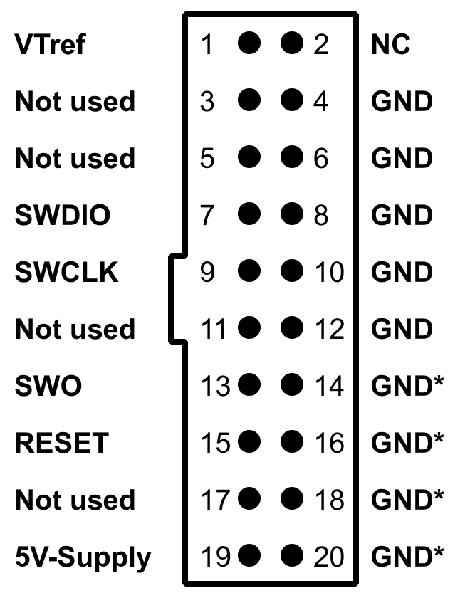

# G3 免拆、串口与屏幕刷机

适用于带屏幕的 **BRY88BBA15G / SENSOR3_ESP32**。G3 有 ESP32 联网模块和 SWM34S 屏幕 MCU，两者分别安装。日常设置见 [G3 功能与操作](daikin-g3-guide)，拆机前先阅读[刷机前准备](flash-prep)。

**推荐先免拆安装 ESP32，再通过网页安装屏幕 MCU。** 已安装社区 ESP32 时，可直接从屏幕安装章节开始。

<!-- os-picker -->

## 选择刷机方式

| 当前状态 | 方法 | 所需工具 |
| --- | --- | --- |
| 原厂固件能启动、联网 | [原厂免拆安装 ESP32](#原厂免拆安装-esp32) | 蓝牙 Linux / Mac、Docker、仅本设备的 DNS 配置 |
| ESP32 无法联网，或需要完整备份、恢复 | [串口安装 ESP32](#串口安装-esp32) | 3.3V USB-TTL、稳定 3.3V 电源、Python |
| 社区 ESP32 已联网，原厂或社区屏幕能通信 | [WebUI 安装屏幕 MCU](#webui-安装屏幕-mcu) | Windows / Linux / macOS 浏览器 |
| 屏幕 MCU 无法通信，需要有线恢复 | [J-Link 安装屏幕 MCU](#j-link-安装屏幕-mcu) | 支持 STAR-MC1 的 J-Link、Synwit 插件、稳定 3.3V 电源 |

Windows 的免拆流程通过 SSH 操作同网段的蓝牙 Linux 主机；Linux 和 macOS 可直接配网。串口和 J-Link 方法三种系统均可使用。

## 下载文件

到[固件与资源下载]({{SITE_URL}}#releases)选择“大金空气质量检测（3代）”。本教程使用当前 **v1.0.0-rc.6**；也可使用更新的兼容版本，工具包与固件取自同一发布。

| 用途 | 文件 | 写入方式 |
| --- | --- | --- |
| 原厂免拆安装 ESP32 | `daikin_BRY88BBA15G.ota.bin.raw` | 临时 OTA 服务 |
| 串口安装 ESP32 | `daikin_BRY88BBA15G.all.bin` | 完整镜像，从 `0x0` 写入 |
| 社区 ESP32 网页更新 | `daikin_BRY88BBA15G.ota.bin.signed` | 设置 → 固件更新 |
| 屏幕 MCU 首装、更新与应用恢复 | `daikin_G3_screen.bin` | WebUI，或 J-Link 从 `0x14000` 写入 |
| 免拆工具 | `daikin_G3_migration.tar.gz` | 解压后使用 |
| 可选高清字库 | `daikin_G3_zh32.iotfnt` | 屏幕资源页安装 |
| 校验清单 | `SHA256SUMS` | 与下载文件核对 SHA-256 |

在[当前 RC6 发布页](https://github.com/phicomm-io/iotcloud-community-firmware/releases/tag/v1.0.0-rc.6)下载所需文件及 `SHA256SUMS`。只核对本次使用的文件即可：

<!-- os:windows -->
### Windows：校验文件

在下载目录打开 PowerShell，例如校验串口完整镜像：

```powershell
Get-FileHash .\daikin_BRY88BBA15G.all.bin -Algorithm SHA256
Select-String -Path .\SHA256SUMS -Pattern '  daikin_BRY88BBA15G.all.bin$'
```

<!-- /os -->
<!-- os:linux -->
### Linux：校验文件

在下载目录运行，例如校验串口完整镜像：

```sh
sha256sum daikin_BRY88BBA15G.all.bin
grep '  daikin_BRY88BBA15G.all.bin$' SHA256SUMS
```

<!-- /os -->
<!-- os:mac -->
### macOS：校验文件

在下载目录运行，例如校验串口完整镜像：

```sh
shasum -a 256 daikin_BRY88BBA15G.all.bin
grep '  daikin_BRY88BBA15G.all.bin$' SHA256SUMS
```

<!-- /os -->

两行摘要应相同，大小写不影响比较。对工具包、raw 应用或屏幕镜像校验时，替换为相应文件名。G1/G2 的 `BRY88AX151K` 文件不能用于 G3。

## 原厂免拆安装 ESP32

### 1. 准备工具与临时服务

设备保持 USB 供电，准备 2.4 GHz Wi-Fi。以下用 `192.168.1.10` 表示临时服务主机，`AABBCCDDEEFF` 表示设备实际 **Wi-Fi STA MAC**；运行前替换。STA MAC 从路由器的 DHCP 记录或设备标签核对，蓝牙地址单独记录。

服务主机需要 Python 3、OpenSSL、Docker Compose，设备能访问其 TCP **443 / 8883**。路由器须支持仅为本设备设置 DNS。蓝牙主机放在设备附近，可以和服务主机是同一台。

<!-- os:windows -->
### Windows：通过 Linux 主机运行

准备一台同网段、带蓝牙的 Debian / Ubuntu 主机，按 [Docker 安装说明](https://docs.docker.com/engine/install/)安装 Engine 与 Compose 插件。在 Windows PowerShell 将校验过的工具包和 raw 应用复制过去，再登录：

```powershell
ssh USER@192.168.1.10 'mkdir -p ~/g3-flash'
scp .\daikin_G3_migration.tar.gz .\daikin_BRY88BBA15G.ota.bin.raw USER@192.168.1.10:g3-flash/
ssh USER@192.168.1.10
```

以下免拆命令均在这个 SSH 终端运行：

```sh
sudo apt update
sudo apt install python3 openssl bluez python3-dbus
cd ~/g3-flash
tar -xzf daikin_G3_migration.tar.gz
cd daikin-g3-migrate
cp ../daikin_BRY88BBA15G.ota.bin.raw .
```

<!-- /os -->
<!-- os:linux -->
### Linux：安装与解压

Debian / Ubuntu 安装依赖，并按 [Docker 安装说明](https://docs.docker.com/engine/install/)准备 Engine 与 Compose 插件。以下命令在下载目录运行：

```sh
sudo apt update
sudo apt install python3 openssl bluez python3-dbus
tar -xzf daikin_G3_migration.tar.gz
cd daikin-g3-migrate
cp ../daikin_BRY88BBA15G.ota.bin.raw .
```

<!-- /os -->
<!-- os:mac -->
### macOS：安装与解压

安装 Python 3、OpenSSL 和 [Docker Desktop](https://docs.docker.com/desktop/setup/install/mac-install/)，启动 Docker Desktop。安装 Xcode 命令行工具后，在下载目录解压：

```sh
xcode-select --install
tar -xzf daikin_G3_migration.tar.gz
cd daikin-g3-migrate
cp ../daikin_BRY88BBA15G.ota.bin.raw .
```

macOS 需允许配网工具使用蓝牙。临时服务可运行在本机或同网段的 Linux 主机；使用远端服务时，下面创建、应答和升级命令在服务主机执行，Mac 只运行配网工具。

<!-- /os -->

先确认当前用户执行 `docker info` 和 `docker compose version` 成功；Linux 的 Docker 用户权限按[安装后配置](https://docs.docker.com/engine/install/linux-postinstall/)设置。随后在工具目录用普通用户创建服务：

```sh
python3 init.py --address 192.168.1.10 --device AABBCCDDEEFF --output ./lab
docker compose -f ./lab/compose.json up -d
```

### 2. 配置本设备 DNS 与蓝牙配网

仅为这台设备，将下面三个域名解析到 `192.168.1.10`，并让它的 DHCP DNS 指向该解析器。正常重启设备或更新 DHCP 租约，使设置生效：

```text
newlifemulti.daikin-china.com.cn
newlifemulti-cdh.daikin-china.com.cn
newlifemulti-cdh-core.daikin-china.com.cn
```

短按背面网络键进入配网，查找 `SENSOR3_…`。虚拟网关 MAC 固定使用 `020000000001`，网关 IP 填临时服务主机 IP。

<!-- os:windows linux -->
### Windows / Linux：BlueZ 配网

在蓝牙 Linux 主机运行 `bluetoothctl`，依次输入 `power on`、`scan on`，记录选中设备的名称和蓝牙地址，然后输入 `scan off`、`quit`。在工具目录创建私有配置：

```sh
cp wifi.example.json wifi.private.json
chmod 600 wifi.private.json
nano wifi.private.json
```

填写实际值，示例：

```json
{
  "address": "AA:BB:CC:11:22:33",
  "device_name": "SENSOR3_AABBCC",
  "ssid": "YOUR_2G_WIFI",
  "password": "YOUR_WIFI_PASSWORD",
  "gateway_ip": "192.168.1.10",
  "gateway_mac": "020000000001"
}
```

保存后执行：

```sh
/usr/bin/python3 provision_linux.py < wifi.private.json
```

<!-- /os -->
<!-- os:mac -->
### macOS：CoreBluetooth 配网

复制配置，填写设备蓝牙名称、2.4 GHz Wi-Fi、密码及服务主机的 `gateway_ip`；保留示例中的虚拟网关 MAC：

```sh
cp wifi.example.plist wifi.private.plist
chmod 600 wifi.private.plist
open -e wifi.private.plist
./build_macos.sh
./IotcloudG3Provision.app/Contents/MacOS/provision "$PWD/wifi.private.plist"
```

接受系统蓝牙授权。工具发送原厂所需的 Wi-Fi 和虚拟网关配置。

<!-- /os -->

配网成功后蓝牙会关闭；需要重发时再次短按背面网络键。长按该键会触发复位。

### 3. 应答网关并安装 ESP32

在服务主机另开终端，进入同一工具目录，运行一个应答器：

```sh
python3 local_gateway_responder.py --device AABBCCDDEEFF \
  --gateway 020000000001 --host 192.168.1.10 \
  --empty-gateway --weather-code 1 --seconds 600
```

等日志中 `snapshot_upload`、`get_weather`、`login_ipbox`、`get_filter_sensor3`、`get_error_sensor3` 均得到应答，再在另一个终端启用升级：

```sh
python3 enable.py --directory ./lab --device AABBCCDDEEFF \
  --firmware ./daikin_BRY88BBA15G.ota.bin.raw --version V99.00.00
docker compose -f ./lab/compose.json up -d --no-deps --force-recreate https
python3 trigger.py --device AABBCCDDEEFF --host 192.168.1.10 \
  --version V99.00.00 --trigger-esp32
docker compose -f ./lab/compose.json logs -f https
```

`V99.00.00` 是这次原厂升级使用的目标标签；社区启动后显示实际 RC6 版本。等待 `artifact` 日志显示 HTTP 200 和完整传输长度，随后设备自动重启。此步骤只更新 ESP32，原厂屏幕继续保留。

### 4. 确认与清理

从路由器查找设备 IP，浏览器打开 `http://设备IP/`，核对型号 G3、版本、Wi-Fi 与传感器读数。原厂屏幕可使用当前温湿度和天气图标；布局和主题需安装下文的社区屏幕固件。

确认成功后撤销本设备的三项 DNS 覆盖、恢复 DHCP DNS，停止应答器并关闭临时服务：

```sh
docker compose -f ./lab/compose.json down
```

删除临时 `lab` 与填写过的 Wi-Fi 配置文件。未出现下载请求时，先核对本设备 DNS、虚拟网关和应答日志；完整工具说明见[迁移工具 README](https://github.com/phicomm-io/iotcloud-community-firmware/tree/main/tools/daikin_g3_migrate#readme)。

## 串口安装 ESP32

### 1. 接线与下载模式

断开 USB 和电池后接线，使用独立稳定的 **3.3V 电源**，电源与 USB-TTL 共地。USB-TTL 需要 3.3V 逻辑电平；设备 USB 电源口不等于下载串口。

| ESP32 信号 | 连接 |
| --- | --- |
| 3V3 | 独立 3.3V 电源 |
| GND | 电源负极、USB-TTL GND |
| GPIO1 / U0TXD | USB-TTL RX |
| GPIO3 / U0RXD | USB-TTL TX |
| GPIO0 | 下载时接 GND，刷完后解除 |
| EN / CHIP_PU | 下载时短暂拉低后释放，复位 ESP32 |

GPIO16 / GPIO17 是 ESP32 与屏幕之间的业务串口。烧录使用上表的 **GPIO1 / GPIO3**。按[乐鑫下载模式说明](https://docs.espressif.com/projects/esptool/en/latest/esp32/advanced-topics/boot-mode-selection.html)，保持 GPIO0 接地后复位或上电进入 ROM 下载模式；每次命令需要重新握手时可重复这个动作。

### 2. 安装工具并备份

安装 Python **3.10 或更新版本**，关闭占用串口的终端软件。以下示例使用 esptool 5，替换实际端口；命令中的 `--before no-reset --after no-reset` 配合手动复位。

<!-- os:windows -->
### Windows：PowerShell

在设备管理器“端口”中查看 USB-TTL 的 COM 号。以下以 `COM5` 为例：

```powershell
py -3 -m venv .venv
.\.venv\Scripts\python.exe -m pip install "esptool>=5,<6"
.\.venv\Scripts\python.exe -m esptool --chip esp32 --port COM5 --baud 115200 --before no-reset --after no-reset read-flash 0 0x800000 g3-stock-1.bin
.\.venv\Scripts\python.exe -m esptool --chip esp32 --port COM5 --baud 115200 --before no-reset --after no-reset read-flash 0 0x800000 g3-stock-2.bin
Get-FileHash .\g3-stock-1.bin, .\g3-stock-2.bin -Algorithm SHA256
```

<!-- /os -->
<!-- os:linux -->
### Linux：终端

安装 `python3-venv`，将当前用户加入串口设备所属组（常见为 `dialout`），重新登录后操作。以下以 `/dev/ttyUSB0` 为例：

```sh
python3 -m venv .venv
. .venv/bin/activate
python -m pip install 'esptool>=5,<6'
python -m esptool --chip esp32 --port /dev/ttyUSB0 --baud 115200 --before no-reset --after no-reset read-flash 0 0x800000 g3-stock-1.bin
python -m esptool --chip esp32 --port /dev/ttyUSB0 --baud 115200 --before no-reset --after no-reset read-flash 0 0x800000 g3-stock-2.bin
sha256sum g3-stock-1.bin g3-stock-2.bin
```

<!-- /os -->
<!-- os:mac -->
### macOS：终端

用 `ls /dev/cu.*` 查找 USB-TTL 端口，以下以 `/dev/cu.usbserial-0001` 为例：

```sh
python3 -m venv .venv
. .venv/bin/activate
python -m pip install 'esptool>=5,<6'
python -m esptool --chip esp32 --port /dev/cu.usbserial-0001 --baud 115200 --before no-reset --after no-reset read-flash 0 0x800000 g3-stock-1.bin
python -m esptool --chip esp32 --port /dev/cu.usbserial-0001 --baud 115200 --before no-reset --after no-reset read-flash 0 0x800000 g3-stock-2.bin
shasum -a 256 g3-stock-1.bin g3-stock-2.bin
```

<!-- /os -->

两个文件均应为 **8388608 字节**、SHA-256 相同。将备份及摘要私下保存，再继续写入。

### 3. 写入完整镜像

校验 `daikin_BRY88BBA15G.all.bin` 后，从 **`0x0`** 写入。完整镜像会替换 ESP32 启动程序、分区表和应用，Wi-Fi 等设置需重新核对；无需额外执行整片擦除。

<!-- os:windows -->
```powershell
.\.venv\Scripts\python.exe -m esptool --chip esp32 --port COM5 --baud 115200 --before no-reset --after no-reset write-flash 0x0 daikin_BRY88BBA15G.all.bin
.\.venv\Scripts\python.exe -m esptool --chip esp32 --port COM5 --baud 115200 --before no-reset --after no-reset verify-flash 0x0 daikin_BRY88BBA15G.all.bin
```
<!-- /os -->
<!-- os:linux -->
```sh
python -m esptool --chip esp32 --port /dev/ttyUSB0 --baud 115200 --before no-reset --after no-reset write-flash 0x0 daikin_BRY88BBA15G.all.bin
python -m esptool --chip esp32 --port /dev/ttyUSB0 --baud 115200 --before no-reset --after no-reset verify-flash 0x0 daikin_BRY88BBA15G.all.bin
```
<!-- /os -->
<!-- os:mac -->
```sh
python -m esptool --chip esp32 --port /dev/cu.usbserial-0001 --baud 115200 --before no-reset --after no-reset write-flash 0x0 daikin_BRY88BBA15G.all.bin
python -m esptool --chip esp32 --port /dev/cu.usbserial-0001 --baud 115200 --before no-reset --after no-reset verify-flash 0x0 daikin_BRY88BBA15G.all.bin
```
<!-- /os -->

确认写入和校验成功后断电，解除 GPIO0 接地并拆除下载接线，再恢复电池与 USB。长按正面键约 2 秒开机；联网失败时按[配网说明](quick-start)连接社区热点，打开 **http://192.168.0.1** 配置 Wi-Fi。随后核对 G3 型号、版本和传感器读数。

## WebUI 安装屏幕 MCU

Windows、Linux、macOS 使用相同步骤。先安装配套社区 ESP32，保持 USB 供电，在局域网浏览器**直接打开设备 IP**，进入“设置 → 屏幕 → 资源与升级”。原厂屏幕首次安装与社区屏幕后续更新均使用这个入口。

| 方法 | 操作 |
| --- | --- |
| 在线安装 | 选择更新来源，点击“检查更新”→“安装屏幕更新” |
| 文件安装 | 校验同一发布的 `daikin_G3_screen.bin`，选择文件→“上传并安装” |

等待页面显示“屏幕固件已安装并正常启动”，再核对屏幕版本、页面和传感器读数。安装自动完成传输、校验与激活，保留原厂引导区；无需先安装 `recovery.bin` 或导出引导区。首次安装和后续更新都使用普通 `daikin_G3_screen.bin`。

可选字库 `daikin_G3_zh32.iotfnt` 在同一资源页在线安装或上传；正常 MCU 更新保留已安装字库。后续 ESP32 更新使用“设置 → 固件更新”，选对应签名包。

## J-Link 安装屏幕 MCU

### 1. 工具与接线

使用支持 **STAR-MC1** 的 J-Link。[芯片厂商说明](https://www.synwit.cn/servicesupport/447.html)要求 J-Link 硬件 V9 或更新版本。安装适合电脑系统的 [SEGGER J-Link 软件](https://www.segger.com/downloads/jlink/)，以及下面的 Synwit 烧录插件。

断开 USB 和电池后接线，使用独立稳定的 3.3V 电源，接好后再上电。J-Link 的 VTref 是电压检测输入，不是供电输出。

| 屏幕 MCU 信号 | J-Link 信号 | 标准 20 针接口 |
| --- | --- | --- |
| PB14 / SWDIO | SWDIO | 7 |
| PB12 / SWCLK | SWCLK | 9 |
| P50 / nRESET 测试点 | nRESET | 15 |
| 3V3 | VTref，并接独立 3.3V 电源 | 1 |
| GND | GND，并与电源负极共地 | 4 |

P50 是主板测试点名称。小型 J-Link 按自身信号标记接线，标准针号只适用于下图接口。



### 2. 安装 Synwit 插件

下载并解压[芯片厂商 JFlash 插件](https://github.com/Synwit-Co-Ltd/JFlash/archive/7dc3a294fbfc23b7e533006ad301354f597777a6.zip)。使用新版 J-Link，将其中的 `JLinkDevices.xml` 与 `Synwit` 文件夹放成以下结构：

```text
JLinkDevices/
  Synwit/
    JLinkDevices.xml
    Devices/
      Synwit/
        SWM341xE.FLM
        ...
```

<!-- os:windows -->
### Windows：插件目录与启动命令

`JLinkDevices` 位于 `%APPDATA%\SEGGER\JLinkDevices`。在 PowerShell 中，将 J-Link 安装目录加入本次终端的 PATH，例如：

```powershell
$env:Path = 'C:\Program Files\SEGGER\JLink;' + $env:Path
JLink.exe -Device SWM341xE -If SWD -Speed 100 -AutoConnect 1
```

<!-- /os -->
<!-- os:linux -->
### Linux：插件目录与启动命令

`JLinkDevices` 位于 `~/.config/SEGGER/JLinkDevices`。安装 SEGGER 软件及其 USB 规则后，在固件目录运行：

```sh
JLinkExe -Device SWM341xE -If SWD -Speed 100 -AutoConnect 1
```

<!-- /os -->
<!-- os:mac -->
### macOS：插件目录与启动命令

`JLinkDevices` 位于 `~/Library/Application Support/SEGGER/JLinkDevices`。在固件目录运行，将下例程序路径替换为实际安装目录：

```sh
/Applications/SEGGER/JLink/JLinkExe -Device SWM341xE -If SWD -Speed 100 -AutoConnect 1
```

<!-- /os -->

多只调试器同时连接时，在启动参数中增加 `-USB 调试器序列号`。确认识别为 `SWM341xE`、SWD 已连接且 VTref 约为 3.3V，再继续。

### 3. 先备份，再写应用

在 J-Link Commander 中输入以下命令，暂停 MCU 并读取两份 512 KiB 内部 Flash：

```text
h
savebin g3-mcu-stock-1.bin 0x0 0x80000
savebin g3-mcu-stock-2.bin 0x0 0x80000
```

在另一个终端用本页的 SHA-256 命令核对两份文件：均应为 **524288 字节**且摘要相同。保留备份；文件含本机引导与配置。校验下载的 `daikin_G3_screen.bin` 后，回到 J-Link Commander：

```text
loadfile daikin_G3_screen.bin 0x14000 noreset
verifybin daikin_G3_screen.bin 0x14000
savebin g3-mcu-installed.bin 0x14000 0x67000
```

当前 RC6 应用为 **421888 字节**，范围为 `0x14000` 至 `0x7afff`。回读文件的 SHA-256 应与下载镜像相同。**不要执行整片 erase，也不要把屏幕应用写到 `0x0`**；保留前 80 KiB 引导区和 `0x7e000` 起的配置区。

校验通过后输入 `r`、`g`、`exit`。断电、拆除调试接线，再恢复原机供电，长按正面键约 2 秒开机。打开设备网页，确认屏幕 MCU 版本和读数；高清字库通过 WebUI 单独安装。

提示 `Unknown device` 时检查插件目录；提示 `Specific core setup failed` 时核对 J-Link 硬件和 STAR-MC1 支持。屏幕应用恢复要求引导区完整；引导损坏时按[原厂备份与恢复](stock-backups#大金-esp32-与屏幕)恢复本机引导。烧录命令说明见 [SEGGER J-Link Commander](https://kb.segger.com/J-Link_Commander)。
