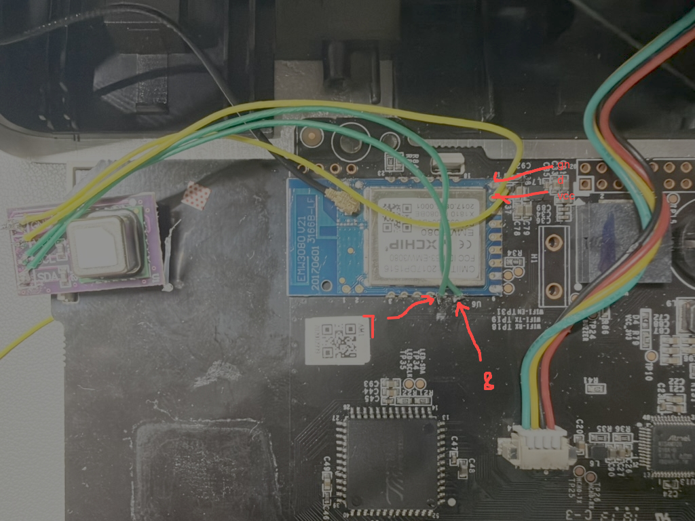

# M1 空气检测仪 功能与操作

M1 固件提供 PM2.5、甲醛、温湿度读数，屏幕亮度设置，并可作为 A1 空气净化器的联动数据源。本文介绍安装完成后的日常操作；首次安装见 [M1 刷机](a1-m1-flash)。

**主控兼容性：** 原厂 11.x 推荐使用 GPL-3.0 开源主控；17.1.2.3 / 17.x 差异较大、待分析，暂不建议迁移。联网与主控版本分别查看，无法读取的版本显示为未知。

## 先分清两种固件

M1 内部有 **Wi-Fi MCU（EMW3080 联网模块）**和**传感器主控（ATSAMD20G18A）**。前者负责联网与网页，后者与机内传感器通信，并控制屏幕和蜂鸣器。普通网页“固件更新”只更新 Wi-Fi MCU，不会一起更新传感器主控。

当前使用基线为 **Wi-Fi v1.0.0-rc.1 + 开源传感器主控 v1.0.0-rc**，两者分别下载、分别升级。双区域用户读数、双击和 PM2.5 稳定处理需要配套版本；只看原有读数可继续使用原厂主控。既有提示音与音乐的最低主控版本为 v0.9.3，颗粒物详情需要 v0.9.4 的完整帧能力。主控没有 WebUI 上传入口，请按[电脑脚本通过 API 升级](m1-mcu-update)操作；功能对应关系见[主控固件说明](m1-mcu-firmware)。

## 首页读数

首页展示实时空气质量信息：

| 读数 | 说明 |
| --- | --- |
| **PM2.5** | 颗粒物浓度 |
| **甲醛** | 甲醛浓度 |
| **温度** | 环境温度 |
| **湿度** | 相对湿度 |

界面按读数等级给出颜色与文字判定（优 / 良 / 差等）。

## 颗粒物详情

搭配支持完整帧读取的传感器主控（主控 v0.9.4 已发布此能力），本地网页首页提供**“颗粒物详情”**卡片，可直接查看 PM1.0、PM10 和六档累计颗粒数；PM2.5 仍显示在原主读数卡片。展开详情可查看 CF=1 浓度和原始诊断数据。“两套浓度”是同一传感器的大气环境 / CF=1 两种口径；颗粒数的单位为每 0.1 L 空气中的颗粒数量，不是 μg/m³。

数据过期、预热或故障时，不可用的测量值显示“—”。看不到卡片或提示不支持时，先核对 Wi-Fi 与传感器主控的版本和能力。新增读数支持 MQTT 上报与 Home Assistant 自动发现，实际 Home Assistant 实例接入尚未验收。完整说明见[读取更多传感器数据](m1-mcu-firmware)。

## 外接 SCD40 二氧化碳传感器（实验性）

支持 SCD40 的测试固件可通过 I²C 读取 CO₂，识别到传感器后网页首页自动显示 CO₂ 数值（ppm）。新打开页面时，仅收到有效读数才显示卡片；若传感器读数已过期则隐藏。当前页面已取得有效读数后再过期，保留本次页面会话最后一次有效值，改为灰色并标注“已过期”。尚无有效读数时显示“—”；刷新页面会清除缓存。原有温湿度读数仍来自 M1 自带传感器。

目前实机已读到有效数据，但连续采样曾停止，稳定性验证尚未通过。本功能仍在测试中，不代表正式发布版本已支持。

断电后接线，并根据实板确认焊点。以下 GPIO 是 SDK 信号名，不是排针序号：

照片中的手写 **7 / 8 是 GPIO7 / GPIO8 信号名**，对应下表 SCL / SDA，不是模组物理引脚编号。GND、VCC 箭头用于定位供电焊点，接线前仍需按实板确认电压和极性。

| M1 信号 | SCD40 模组 |
| --- | --- |
| GPIO8（I²C1 SDA） | SDA |
| GPIO7（I²C1 SCL） | SCL |
| 稳定电源（按模组额定电压） | VCC / VIN |
| GND | GND |

SDA、SCL 分别上拉到 **3.3 V**，短线可从 4.7 kΩ 开始；模组已有接到 3.3 V 的 10 kΩ 上拉时可先使用现有上拉。确认上拉接向，不要将 M1 总线拉到 5 V。使用短线，电源须能承受测量峰值电流，不能由 GPIO 供电。GPIO9 / GPIO10 用于原机 UART，不要占用。

参考：[Sensirion SCD40](https://sensirion.com/cn/products/catalog/SCD40)、[官方开发与供电说明](https://developer.sensirion.com/product-support/scd4x-co2-sensor)。

## 屏幕亮度

屏幕亮度可在网页中调整，设置会保存到设备并进行回执确认。也可以通过 MQTT 命令调整亮度，独立 MQTT 客户端修改后设备会回传设置值。

## Wi-Fi 图标与错误图标

M1 使用原面板上的两个图标提示网络状态，**它们是独立输出**：

| 状态 | Wi-Fi 图标 | 错误图标 |
| --- | --- | --- |
| 正常 | 常亮 | 灭 |
| Wi-Fi 故障 | 闪烁 | 闪烁 |
| 已配置 MQTT 连接异常 | 常亮 | 两长两短 |

关闭输出时对应 GPIO 切换为低电平。**未配置 MQTT 不报 MQTT 故障。**

> 原厂主控的甲醛 / PM2.5 色灯阈值与手动颜色尚无已验证的通用设置协议；开源主控的扩展见[主控说明](m1-mcu-firmware)。

## 按键与恢复

配套升级支持分段恢复的**开源传感器 MCU 与 Wi-Fi 固件**后：

- 单击开关屏幕，等待约 350 毫秒以区分双击。闹钟响铃时，双击只停止闹钟；未响铃时，按配置整体切换原始 / 用户读数。
- 按住至少 3 秒、未满 10 秒松手：清除 Wi-Fi 和网页密码，重新配网；保留 MQTT 和其他设置。
- 持续按满 10 秒：恢复出厂设置，清除 Wi-Fi、MQTT、网页密码及其他联网模块设置；主控中独立保存的自定义音乐保留。

两种恢复操作均先保存设置，再重启传感器 MCU 与 Wi-Fi MCU；不需要先连接 Wi-Fi。升级期间不接受恢复手势。原厂主控继续使用原面板的长按重配网事件，不支持上述分段手势。硬件恢复见 [M1 刷机](a1-m1-flash)，也可在 WebUI 执行完整重置。

当前 EMW3080 SDK 不提供 WPA3 接入。配网请使用 WPA2-PSK/AES；WPA2/WPA3 过渡网络须允许 WPA2 客户端。参见[模组规格](https://docs.mxchip.com/attach/zh/DS0122CN_EMW3080_V2.8.pdf)。

## 作为 A1 的联动数据源

M1 只检测、上报并应答**已授权**的 A1，不主动控制净化器，也不主动轮询 A1。

只需在 A1 添加本机 MAC 和可选 IP。MQTT 用于建立会话，传感器查询走局域网 UDP。M1 页面只读显示会话状态，最多同时保留四台 A1；无需维护许可列表或配对码。

绑定与联动规则见 [MQTT 与联动](mqtt-link#a1-与传感器联动)。

## IoTCloud 与 Home Assistant

IoTCloud 的 M1 详情页支持同样的 CO₂ 卡片，设备列表显示有效 CO₂ 摘要。识别并取得 SCD40 有效读数后，Home Assistant 通过 MQTT 自动发现“二氧化碳”实体（ppm）；超过 20 秒未更新时，该实体变为不可用，不影响 M1 原有传感器实体。

## MQTT

M1 固定使用 **TMCP（v2）** 主题，不提供 Legacy 模式选择。Home Assistant 接入与平台配置见 [MQTT 与联动](mqtt-link)。

## v1 候选版用户读数与 PM2.5 稳定处理

v1 候选版提供双路屏幕读数与 PM2.5 稳定处理，需配套开源主控、联网固件与前端。这是预发布版本，v1.0.0 稳定版尚未发布。

在设备设置的“设备屏幕用户读数”中，甲醛区域和 PM2.5 区域可分别选择本机传感器、同一 MQTT 账户和代理下的其他设备（TC1 功率、A1 主风机生效输出、大金 CO₂ 等），或 API / 手动写入。A1 取当前生效输出百分比（0–100%，新风版相同）。其他设备的 MAC 支持 `aabbccddeeff` 和 `aa:bb:cc:dd:ee:ff` 两种写法，字母不区分大小写。

**RC.1 来源配置：** 来源设备通过 schema 2 发布字段描述，M1 显示配置 schema 4 按设备 + 稳定字段 ID 选择匹配 `number` 类型和单位的读数，不再按机型适配。名称用于展示，不作为保存绑定；TC1 功率、A1 生效输出和传感器读数使用相同接口。无效值为 `null`，不伪装成零；新快照立即撤销缺失、无效或不支持字段的旧读数，保留已保存来源设置。请同时更新来源设备、M1 联网固件与配套前端。旧联网 RC 已 deprecated，对应 MQTT / HTTP 显示配置接口与 RC.1 不兼容；独立传感器主控 RC 版本不变。自定义接入见[通用显示配置 API](https://phicomm-io.github.io/iotcloud-community-protocols/device-http/#m1-generic-profile4)。

每个区域只有三位数字。**PM2.5 区域只能显示整数**，四舍五入后最多显示 `999`，正数溢出仍显示 `999`。**甲醛区域的小数点固定在第一位之后**，支持以下五种方式；这些转换只用于本机 / MQTT 来源的读数：

| 显示方式 | 规则与示例 | 显示上限 |
| --- | --- | --- |
| 整数 | 四舍五入，`123.6` → `124` | `999` |
| 千位自动缩放 | 小于 1000 显示整数；达到 1000 后除以 1000，`1234` → `1.23` | 缩放后 `9.99` |
| 两位小数 | 固定 x.xx，`1.234` → `1.23` | `9.99` |
| 一位小数，末位补 0 | 固定 x.x0，`1.26` → `1.30` | `9.90` |
| 固定除以 1000 | 除以 1000 后显示 x.xx，`1234` → `1.23` | `9.99` |

正数超出显示上限时保持上限值。原有“甲醛”/“PM2.5”字样与本区域单位可分别显示或隐藏：甲醛区域固定为 **mg/m³**，PM2.5 区域固定为 **µg/m³**。屏幕无法显示任意文字或 ppm、W、% 等其他单位；显示外部数据时，请按数据含义选择是否保留原字样和单位。

面板玻璃的 19 组布局如下，**左侧为 PM2.5，右侧为甲醛**。表中的 `8` 仅为数字位示意，不代表具体读数；温湿度数字位的布局也不代表传感器采样精度。

| 编号 | 位置 | 数字位或图案 |
| --- | --- | --- |
| 1 | 顶部左侧 | 日期 `8888-88-88`，含连字符 |
| 2 | 顶部中间偏右 | 时间 `88:88`，含冒号 |
| 3 | 顶部最右侧 | Wi-Fi 图标与 `×` |
| 4 | 左侧中部上方 | “PM2.5”字样 |
| 5 | 左侧中部 | PM2.5 数值 `888` |
| 6 | 左侧中部数值右侧 | `µg/m³` 单位 |
| 7 | 右侧中部上方 | “甲醛”字样 |
| 8 | 右侧中部 | 甲醛数值 `8.88`，含固定小数点 |
| 9 | 右侧中部数值右侧 | `mg/m³` 单位 |
| 10 | 左下方 | 横向圆角色灯条，表示 PM2.5 状态 |
| 11 | 右下方 | 横向圆角色灯条，表示甲醛状态 |
| 12 | 左下角 | 温度计图标 |
| 13 | 左下方 | “温度”字样 |
| 14 | 左下偏右 | 温度数值 `88.8`，含小数点 |
| 15 | 温度数值右侧 | `°C` 单位 |
| 16 | 右下方 | 水滴图标 |
| 17 | 右下偏中 | “湿度”字样 |
| 18 | 右下偏右 | 湿度数值 `88.8`，含小数点 |
| 19 | 右下角 | `%` 单位 |

表中第 10、11 项分别对应 PM2.5、甲醛区域的状态灯条。每个区域有左、中、右三个灯位，每个灯位的红、绿、黄段都可独立开关，共 **9 段**；同一灯位允许多色同时开启。颜色也可按转换前的原始物理值设置两个阈值：低于下阈值为绿，达到下阈值为黄，达到上阈值为红。

选择 API / 手动写入并保存后，直接指定 `0–999` 的整数、是否点亮小数点、原字样、原单位及全部 9 段灯。甲醛区域写数字 `123` 并开启小数点即显示 `1.23`；PM2.5 区域不允许开启小数点。**API 写入不套用上述显示方式或颜色阈值**，小数或超过 `999` 的数字会被拒绝。写入值仅在有效时间内显示，需持续更新；完整字段与调用方法见[显示 API 开发文档](https://phicomm-io.github.io/iotcloud-community-protocols/device-http/#m1-display_profile-api)。

将“双击操作”设为“整体切换原始／用户读数”，双击即可同时切换两个区域；闹钟响铃时优先停止闹钟。两路分别设置有效时间：数据缺失、过期、离线或无效时，仅对应区域恢复原始读数，另一路不受影响。原始传感器采集与告警不受用户读数替换影响。

甲醛与 PM2.5 可分别设置超阈值蜂鸣报警，默认关闭、按需开启。色灯阈值、闹钟和手动鸣叫分别控制，不受该开关影响。
