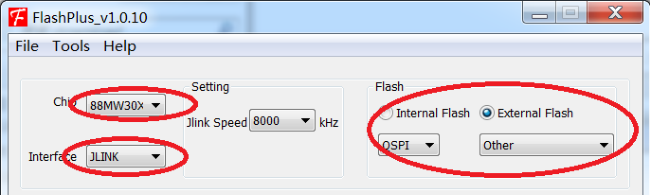
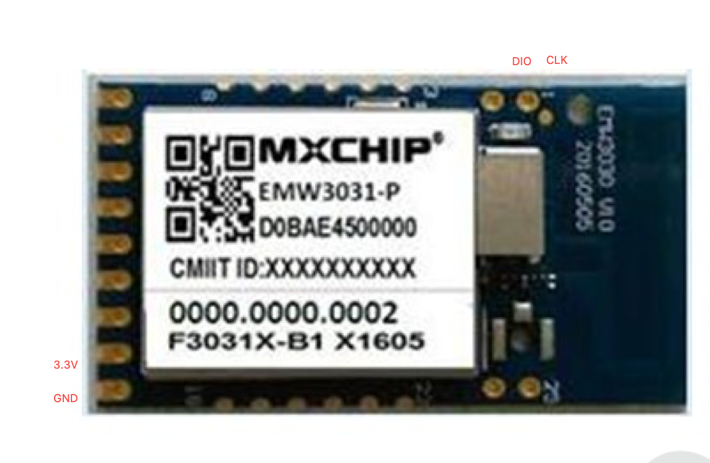
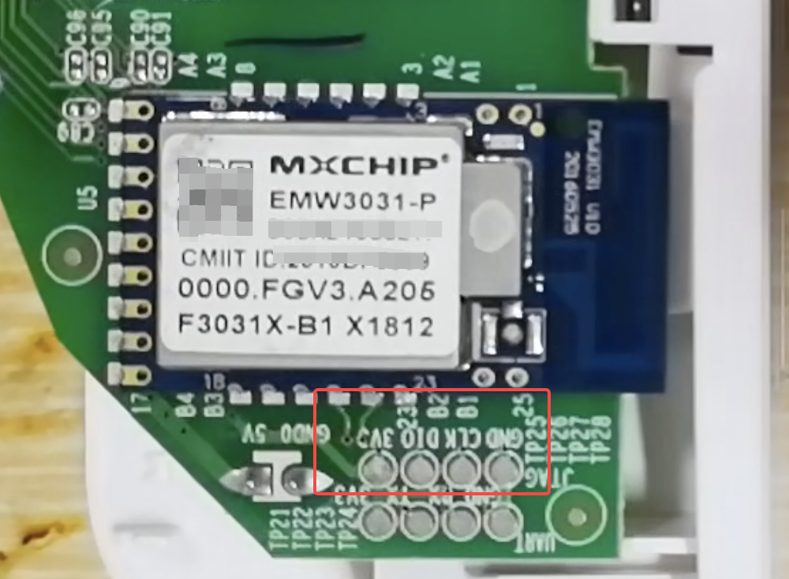
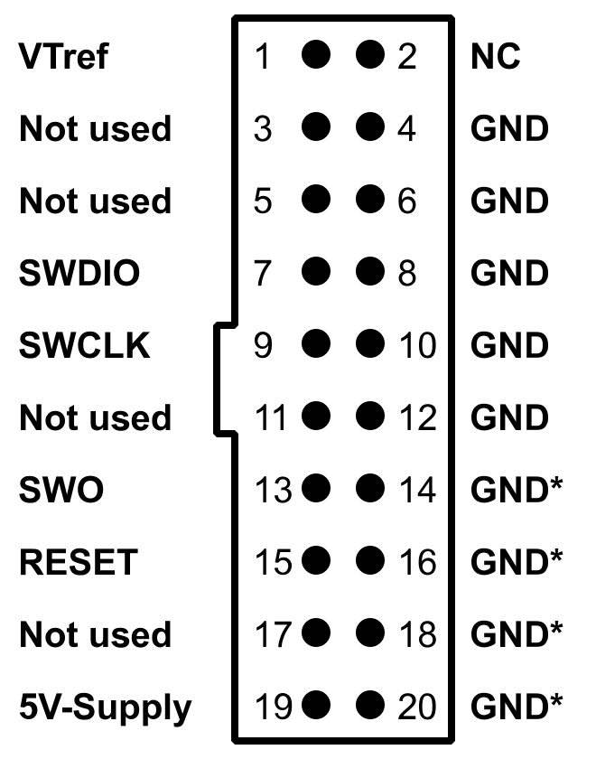

# TC1 有线刷机与恢复（A1 硬件版本）

**仅适用于硬件版本为 A1 的 TC1 智能排插**，模块为 EMW3031。不支持 TC1 A2 硬件。

本页使用 J-Link 拆机烧录。原厂 `1.0.0.26` / `1.0.0.24` 可先选择[免拆刷机图文教程](tc1-no-disassembly-ethernet-wifi-ap)；需要接线时，先阅读[刷机前准备](flash-prep)。

## 工具与拆机

**工具：** Windows 电脑、支持 SWD 的 J-Link、[SEGGER J-Link 驱动](https://www.segger.com/downloads/jlink/)、FlashPlus、独立 3.3V 电源、导线、合适的螺丝刀和焊接工具。

FlashPlus 使用 Marvell 的 EMW3031 烧录配置。可从[资源来源](sources)下载 FlashPlus；[EMW3031 / FlashPlus 工具说明镜像](https://github.com/IoTDevice/phicomm_tc1_a1/blob/master/工具和文档/EMW3031说明文档_flashplus.pdf)包含工具配置与 Flash 布局。

**拆机：** 拆开底部防水垫，拧下螺丝；轻敲底下中部，直到外壳脱开。取出电路板后**确认模块为 EMW3031**。

## 接线：模块飞线或工厂测试点

两种接法使用同一套 SWD 信号，任选一种，不必同时连接。

### 方法一：在模块焊盘飞线

按下图的 **3.3V、GND、DIO、CLK** 标记焊接导线。图片方向以标签和天线位置为准；不要翻面后直接套用左右位置。

### 方法二：使用主板工厂测试点（更方便）

不用在模块边缘焊盘上飞线，可使用下图红框内主板的 **3V3、DIO、CLK、GND** 测试点连接下载器和电源。图中文字方向是倒置的，必须逐个核对丝印；使用探针、夹具或焊线保持可靠接触，不要在擦写中移动。

### 信号对应关系

接线时按**主板丝印和模块引脚**核对，不按线的颜色判断。

| EMW3031 模块引脚 / 主板信号 | J-Link 标准 20 针接口 |
| --- | --- |
| 16：3V3 | 接独立 3.3V 电源，并连接 1：VTref |
| 17：GND | 4：GND，并与电源负极共地 |
| 1 或 3：SWD_CLK / CLK | 9：SWCLK |
| 2 或 4：SWD_DIO / DIO | 7：SWDIO |
| 11：RESET（需要复位连接时） | 15：nRESET |

模块位置见[庆科 EMW3031 数据手册，PDF 第 8 页引脚图（镜像）](https://supp.iczoom.com/images/public/20190118/1547790131015026781.pdf#page=8)。

> **VTref 是电压检测输入，不是 3.3V 电源输出。** 标准 J-Link 的 19 针输出为 5V，**不连接模块**。小型下载器的排针布局可能不同，应按其说明中的 SWCLK、SWDIO、GND、VTref 信号对应连接。

## 烧录步骤

1. **断开排插市电**，接好下载线和独立 3.3V 电源，连接 J-Link 到电脑，打开 FlashPlus。
2. 设置 **Chip = 88MW30X**、**Interface = JLINK**；Flash 选 **External Flash**，接口选 **QSPI**，Type 选 **Other**。
3. **先备份。** 选择 **READ**，Flash address 填 `0`，Length of byte 填 `200000`（界面为十六进制，即 2 MiB），选择 **Save to file**，保存本机完整 Flash。

   读取失败、或文件不是 **2,097,152 字节**时先排查，**不要开始擦写**。备份含本机参数，应自行保管。

4. 选择 **PROGRAM**，Flash Start Address 填 `0`；文件选择 `phicomm_tc1_a1.all.bin`。

   **Erase Mode 选择 `Erase flash sectors by file`，不要选择 `Erase all flash`**；勾选 **Verify after programming**。

5. 当前完整镜像应结束于 `0x1E0000` 之前；**若文件长度超过这个边界，停止并核对对应版本的布局**。点击 **Start**，等待写入完成且校验成功后再断电、拆除下载线。

   **不要自行把源码 CPU 地址填入 Flash Start Address。**

6. 装回外壳后正常上电，连接 `TC1-AP-<MAC后六位>`，访问 `http://192.168.0.1/` 配网。

## 排错

| 现象 | 检查 |
| --- | --- |
| 无法识别芯片 | 检查 3.3V、VTref、共地、CLK/DIO 和驱动；可以降低 J-Link 速度后重试 |
| 写入或校验失败 | 保持市电断开，修复接线后重新烧录 |

## 恢复原厂

可使用**同一台设备**的完整备份，从 Flash 地址 `0` 写回并校验。

> **没有本机备份时，不要整片擦除，或写入他人的设备参数。**

## 之后

安装完成后按[快速开始](quick-start#首次配网)配网，日常操作见 [TC1 功能与操作](tc1-guide)。后续升级用网页 OTA，见[固件更新](firmware-update)。
