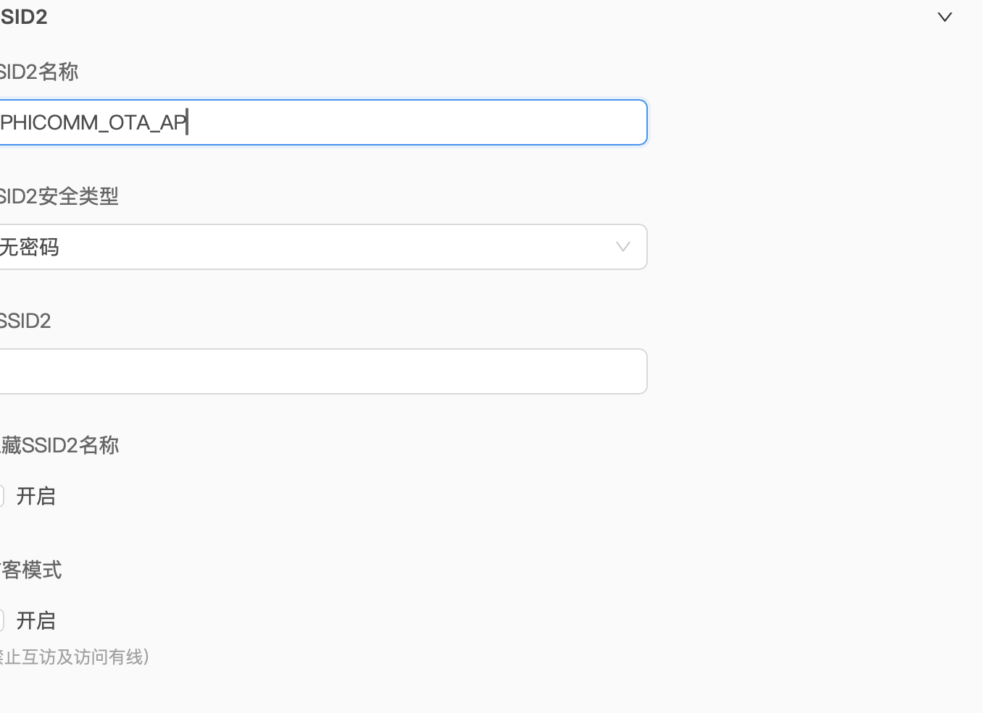
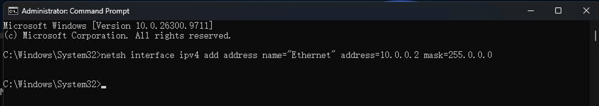
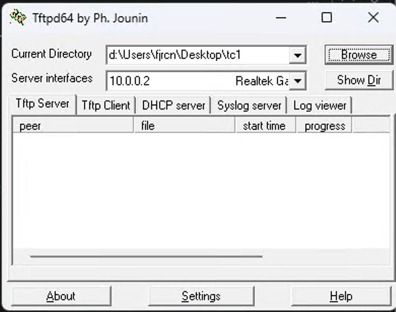
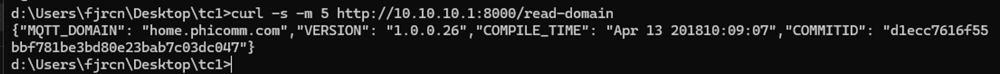
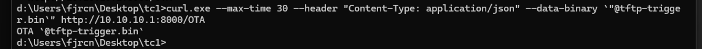

# TC1 免拆刷机：一个有线＋一个无线＋一个 AP

[返回 TC1 免拆刷机](tc1-no-disassembly)

用电脑的**有线网卡传固件、无线网卡发触发请求**，再用一台路由器或 AP 提供刷机热点。本教程完整走一遍连接、下载、触发、首次启动和恢复网络的过程，适用于 Windows、Linux 和 macOS；可选择电脑系统，查看对应操作。

**适用设备：TC1 智能排插 A1 硬件版（EMW3031 / MK3031），原厂固件 1.0.0.26。** TC1 A2、其他原厂版本和 A1 空气净化器不适用。

<!-- os-picker -->

## 1. 准备设备和文件

需要一台同时具有有线和无线网卡的电脑、一根网线，以及支持 **2.4 GHz、无密码 Wi-Fi、无线与 LAN 互通**的路由器或 AP。USB 有线网卡也可以使用。给排插稳定供电，刷机时拔掉排插上的用电设备。

先在电脑上建一个 `tc1-flash` 文件夹，下载这两个文件放进去：

| 下载 | 用途 |
| --- | --- |
| [mico_ota.bin](assets/tools/tc1-no-disassembly/mico_ota.bin) | 已准备好的配套固件，放到 TFTP 服务目录，文件名必须保持不变 |
| [tftp-trigger.bin（payload）](assets/tools/tc1-no-disassembly/tftp-trigger.bin) | 发送给原厂 OTA 接口的触发文件，仅适用于本页设备与版本 |

文件大小分别是 **649,344 字节**和 **397 字节**。[校验和](assets/SHA256SUMS)可用于核对下载文件。这里提供的是固定的教程配套文件，后续日常升级见[固件更新](firmware-update)。

**不需要安装 Python，也不需要改名、拼接固件或生成 payload。** 电脑准备好 `curl` 和 TFTP 服务即可。先下载好所有文件和工具，再切换 Wi-Fi。

<!-- os:windows -->

下载 [Tftpd64](https://pjo2.github.io/tftpd64/)，用于提供 TFTP。打开 CMD 或 PowerShell 检查 curl：

```cmd
curl.exe --version
```

后续统一使用 `curl.exe`，避免 PowerShell 中的同名别名影响参数。

<!-- /os -->

<!-- os:linux -->

准备 `dnsmasq`，第 4 步会用它临时提供 TFTP。Debian / Ubuntu 用户趁网络可用时安装 `dnsmasq-base`。打开终端检查 curl：

```sh
curl --version
```

<!-- /os -->

<!-- os:mac -->

使用系统自带的 TFTP 服务，第 4 步会完成设置。打开「终端」检查 curl：

```sh
curl --version
```

<!-- /os -->

## 2. 设置 AP，并连接网线

电脑发送触发请求后，TC1 会离开自己的配网热点，转而连接 `PHICOMM_OTA_AP` 下载固件。因此，**先把下载网络准备好，再操作 TC1**。

```text
电脑有线网卡（10.0.0.2/8，提供 TFTP 文件）──网线──路由器 / AP 的 LAN 口
电脑无线网卡 ──连接── TC1 配网热点 Phicomm_TC1_XXXX
TC1 收到触发请求后 ──连接── AP 热点 PHICOMM_OTA_AP
```

在路由器或 AP 的无线设置里，选 **2.4 GHz**，设置：

| 设置项 | 填写内容 |
| --- | --- |
| Wi-Fi 名称 / SSID | `PHICOMM_OTA_AP`，注意大小写，不加空格 |
| 安全方式 / 密码 | 开放、无密码 |
| 隐藏 SSID | 关闭 |
| 访客模式 / 客户端隔离 | 关闭，保证无线设备能访问 LAN 里的电脑 |



保存设置后，用网线将电脑接到该路由器或 AP 的 **LAN 口**。路由器无须连接互联网，也无须把 LAN 管理地址改成 `10.0.0.2`；这个地址留给电脑。确认其他设备没有占用它。

电脑的有线与无线网卡**不需要桥接，也不需要开启网络共享**。刷机期间保留两条连接：有线连接 AP，无线连接 TC1。

## 3. 给有线网卡添加 10.0.0.2

TFTP 必须使用 **`10.0.0.2`、掩码 `255.0.0.0`（/8）**，不为这个地址添加网关或 DNS。先记录网卡原来的地址、网关、DNS，以及是否自动获取，方便结束后恢复。

<!-- os:windows -->

### Windows

以管理员身份打开 CMD 或 PowerShell，查询网卡名称和原配置：

```cmd
netsh interface ipv4 show interfaces
ipconfig /all
```

找到连接路由器 LAN 口的**有线网卡**。下面以 `Ethernet` 为例；如果实际名称是「以太网」或其他名称，替换引号内的内容：

```cmd
netsh interface ipv4 add address name="Ethernet" address=10.0.0.2 mask=255.0.0.0
netsh interface ipv4 show addresses name="Ethernet"
```



结果中应出现 `10.0.0.2`。**该命令会使原先通过 DHCP 自动获取地址的网卡改为静态配置**；刷机结束后，原来自动获取的网卡需要恢复 DHCP。参见 [Microsoft 的 netsh 说明](https://learn.microsoft.com/zh-cn/windows-server/administration/windows-commands/netsh-interface)。

<!-- /os -->

<!-- os:linux -->

### Linux

打开终端查询有线网卡名称。下面以 `enp3s0` 为例，替换为实际名称：

```sh
ip -br address
ip route
sudo ip address add 10.0.0.2/8 dev enp3s0
ip -4 address show dev enp3s0
```

<!-- /os -->

<!-- os:mac -->

### macOS

先区分 Wi-Fi 和有线网卡；USB 网卡不一定是 `en0`。下面假设有线网卡为 `en5`：

```sh
networksetup -listallhardwareports
ifconfig en5
sudo ifconfig en5 inet 10.0.0.2 netmask 255.0.0.0 alias
ifconfig en5
```

<!-- /os -->

以**有线网卡实际出现 `10.0.0.2/8`**为完成标志。遇到地址冲突或接口不存在时，先修正，不要继续发送触发请求。

## 4. 启动 TFTP 服务

TFTP 的任务是让 TC1 从电脑读取 `mico_ota.bin`。**payload 留在命令行工作文件夹里，不上传到 TFTP。** 保持服务运行，直到固件传输完成。

<!-- os:windows -->

### Windows：Tftpd64

打开 Tftpd64，完成这些设置：

1. **Current Directory**：点击 **Browse**，选择保存 `mico_ota.bin` 的 `tc1-flash` 文件夹。
2. **Server interfaces**：选择 **`10.0.0.2`**，不要选 Wi-Fi 的地址。
3. 打开 **Tftp Server** 标签，保留窗口以便观察下载记录。无需开启软件里的 DHCP 服务。
4. 若 Windows 防火墙询问，允许 Tftpd64 在这条刷机网络上通信。



<!-- /os -->

<!-- os:linux -->

### Linux：临时 dnsmasq TFTP

以 Debian / Ubuntu 为例，提前安装 `dnsmasq-base`，其他发行版安装提供 `dnsmasq` 命令的软件包。在 `tc1-flash` 文件夹内打开终端，运行：

```sh
sudo apt install dnsmasq-base
tc1_tftp_dir=$(mktemp -d /tmp/tc1-tftp.XXXXXX)
chmod 755 "$tc1_tftp_dir"
install -m 644 mico_ota.bin "$tc1_tftp_dir/mico_ota.bin"
sudo dnsmasq --no-daemon --conf-file=/dev/null --port=0 \
  --listen-address=10.0.0.2 --bind-interfaces --enable-tftp \
  --tftp-root="$tc1_tftp_dir" --log-facility=-
```

保持这个终端运行，另开一个终端执行后续的 `curl`。这条命令临时提供 TFTP，不提供 DNS 或 DHCP。若提示 UDP 69 已占用，先确认现有 TFTP 服务；使用现有服务时，将文件放进它的服务目录，不要重复启动。

<!-- /os -->

<!-- os:mac -->

### macOS：系统自带 TFTP

在 `tc1-flash` 文件夹内打开终端。先确认 `/private/tftpboot` 里没有需要保留的同名固件；有的话先自行备份，再执行：

```sh
sudo mkdir -p /private/tftpboot
sudo cp mico_ota.bin /private/tftpboot/mico_ota.bin
sudo chmod 644 /private/tftpboot/mico_ota.bin
sudo launchctl load -w /System/Library/LaunchDaemons/tftp.plist
```

系统自带服务通过 `/private/tftpboot` 提供文件，没有图形化进度窗口。若提示服务已加载，使用现有服务验证即可。

<!-- /os -->

### 检查文件服务

TFTP 初始请求使用 **UDP 69**，后续传输还会使用服务器的会话端口。防火墙需允许这条刷机网络上的 TFTP 完整传输，不能只放行 UDP 69。

在让 TC1 进入配网模式前，用另一台连接 `PHICOMM_OTA_AP` 的电脑完整下载一次文件。例如，客户端的 curl 支持 `tftp` 协议时，可以运行：

<!-- os:windows -->

```cmd
curl.exe --fail --max-time 30 -o tc1-download-check.bin tftp://10.0.0.2/mico_ota.bin
```

<!-- /os -->

<!-- os:mac linux -->

```sh
curl --fail --max-time 30 -o tc1-download-check.bin tftp://10.0.0.2/mico_ota.bin
```

<!-- /os -->

检查用的电脑若是其他系统，使用其对应的 curl 命令；没有 TFTP 支持时，使用 TFTP 客户端以 **binary / octet** 模式下载。将下载文件与原文件核对大小和 SHA-256；在服务器本机下载不能证明 AP 无线侧已互通。

## 5. 让 TC1 进入配网模式

给 TC1 重新上电，在上电 **3 秒内双击配网键**。LED 慢闪后，应出现开放热点 **`Phicomm_TC1_XXXX`**，末四位因设备而异。

也可以长按配网键，等 LED 快闪后保持一段时间再松开，随后快速短按两次。以配网热点出现为准；看不到时先断电重试，不要直接发送 payload。

电脑用**无线网卡**连接该热点。有线连接和 TFTP 服务保持运行。

<!-- os:windows -->

Windows 提示「无 Internet」时，继续保持连接 TC1。

<!-- /os -->


检查无线网卡已获得 `10.10.10.x`、掩码 `/24` 的地址，然后读取原厂信息。

<!-- os:windows -->

**Windows：**

```cmd
curl.exe --noproxy "*" --fail --max-time 5 http://10.10.10.1:8000/read-domain
```

<!-- /os -->

<!-- os:mac linux -->

```sh
curl --noproxy '*' --fail --max-time 5 http://10.10.10.1:8000/read-domain
```

<!-- /os -->

返回信息中核对 **`VERSION` 为 `1.0.0.26`**，本页截图的 `COMMITID` 为 `d1ecc7616f55bbf781be3bd80e23bab7c03dc047`。如果版本或构建标识不符，停止使用本页 payload；不要仅凭热点名称判断兼容。

<!-- os:windows -->



<!-- /os -->

## 6. 发送 payload，等待固件下载

打开保存 **`tftp-trigger.bin`** 的 `tc1-flash` 文件夹，在这里打开终端。确认 TFTP 正在运行、有线地址仍为 `10.0.0.2`、无线仍连接 TC1，然后**只发送一次**：

<!-- os:windows -->

**Windows（CMD / PowerShell）：**

```cmd
curl.exe --noproxy "*" --max-time 30 --header "Content-Type: application/json" --data-binary "@tftp-trigger.bin" http://10.10.10.1:8000/OTA
```

<!-- /os -->

<!-- os:mac linux -->

```sh
curl --noproxy '*' --max-time 30 --header 'Content-Type: application/json' --data-binary '@tftp-trigger.bin' http://10.10.10.1:8000/OTA
```

<!-- /os -->

`--data-binary` 会原样发送二进制文件。不要把 payload 打开后复制为文本，也不要在命令末尾附上截图中的提示符或反引号。

<!-- os:windows -->



<!-- /os -->

返回 `OTA` 或一串 `A` 只说明接口收到请求，**不能据此判定刷机成功**。设备开始切换网络时，配网热点消失、电脑无线断开属于预期现象；即使 curl 超时，也先观察下载和设备状态，不要立即重复触发。

TC1 随后连接 AP 的 `PHICOMM_OTA_AP`，从电脑下载 `mico_ota.bin`。有 TFTP 日志或进度界面的，应看到读取请求和完整传输记录。此时**电脑无线网卡无需改连 AP**，网线继续负责传输。

保持 TC1、AP 和电脑供电，等待固件下载、校验和重启完成。下载进行中不要关 TFTP、拔网线或给 TC1 断电。

## 7. 连接社区固件，确认完成

刷机成功后，应出现新的开放热点 **`TC1_A1-AP-<MAC 后六位大写>`**。截图中的 `TC1_A1-AP-636D3D` 只是示例，以自己设备的名称为准。


用电脑或手机连接这个新热点，在浏览器打开 **`http://192.168.0.1/`**，确认能进入社区固件本地网页，再填写日常使用的 Wi-Fi。之后的按键、配网和六路开关操作见 [TC1 功能与操作](tc1-guide)。

**新热点出现且本地网页可访问**，才是本流程的完成标志。HTTP 返回、原厂热点消失或一次 TFTP 下载都不能单独证明完成。

## 8. 关闭临时服务，恢复网络

<!-- os:windows -->

关闭 Tftpd64，然后删除本次添加的地址，网卡名称与第 3 步保持一致。

**Windows：**

```cmd
netsh interface ipv4 delete address name="Ethernet" address=10.0.0.2
```

若网卡原来自动获取地址，还需恢复 DHCP；原来使用静态地址的，按刷机前记录恢复，**不要运行 DHCP 命令**：

```cmd
netsh interface ipv4 set address name="Ethernet" source=dhcp
```

<!-- /os -->

<!-- os:linux -->

在运行临时 dnsmasq 的终端按 `Ctrl+C`，然后删除本次添加的地址，替换为实际有线网卡名称：

```sh
sudo ip address del 10.0.0.2/8 dev enp3s0
```

<!-- /os -->

<!-- os:mac -->

若 TFTP 是本次临时启用的，先关闭它，再删除本次添加的地址，网卡名称与第 3 步保持一致：

```sh
sudo launchctl unload -w /System/Library/LaunchDaemons/tftp.plist
sudo ifconfig en5 inet 10.0.0.2 -alias
```

<!-- /os -->

关闭临时开放热点，或恢复路由器原来的 Wi-Fi 名称与密码；撤销本次临时防火墙放行。临时服务目录中的本次固件也可删除。

## 常见问题

| 现象 | 处理 |
| --- | --- |
| curl 找不到 payload | 在 `tc1-flash` 文件夹内打开终端，确认文件名不是 `tftp-trigger.bin.txt` |
| read-domain 无响应 | 检查无线是否仍连 TC1、是否获得 `10.10.10.x/24`；暂停影响本地路由的 VPN / 代理 |
| TFTP 没有下载请求 | 核对 AP 为开放的 2.4 GHz、名称完全一致、无线与 LAN 互通；检查服务绑定与防火墙 |
| TFTP 开始后停住 | 检查服务器会话端口是否被拦截、电脑是否休眠、网线是否松动 |
| 下载完成后仍无新热点 | 保持供电观察，核对文件大小与校验和；不要连续重复发送触发请求 |
